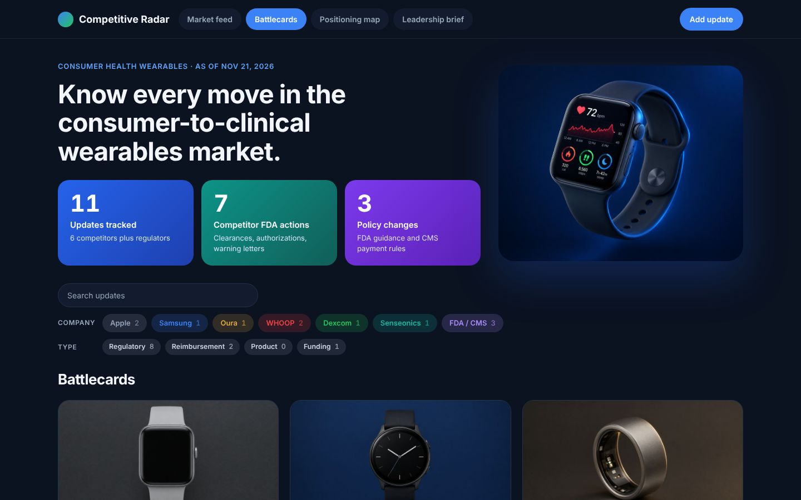

# Competitive Radar: Consumer Health Wearables

A competitive intelligence workspace for the consumer-to-clinical wearables market. It combines a sourced market feed, battlecards, a positioning map and a leadership brief you can copy in one click.

**[Live demo](https://warisham.github.io/wearables-competitive-radar/)**

## The problem

Competitive updates in digital health are scattered across FDA letters, CMS rules, earnings calls and press releases. Sales teams need a one-page answer to "how do we win against X?" and leadership needs a two-minute brief. Most teams keep this in slide decks that go stale.

## Four views

| View | What it does |
| --- | --- |
| **Market feed** | Update cards, newest first. Each has a "why it matters" line and a source. Filter by company and type (Regulatory, Reimbursement, Product, Funding), or search. |
| **Battlecards** | A sales playbook for Apple, Samsung, Oura, WHOOP, Dexcom and Senseonics: positioning, strengths, gaps, how to win, one question to ask the buyer, and the latest move. |
| **Positioning map** | A 2x2 of consumer wellness vs clinical grade against single device vs care platform, with each player shown by product and the open space marked. |
| **Leadership brief** | An auto-written summary for the last 30 or 90 days, 12 months, or all time, ready to paste into email or Slack. |

You can add new updates in the app.

## Seed data (as of November 2026)

The seed data includes:
- FDA's January 2026 general wellness and clinical decision support guidance
- The WHOOP warning letter (July 2025) and its reversal (June 2026)
- CMS's new RPM codes for 2026 (99445, 99470) and the 2027 revaluation
- Oura's IPO filing
- CGM clearances: Dexcom Stelo (over the counter) and Senseonics Eversense 365 (one-year implant)
- Cleared smartwatch features from Apple and Samsung

Entries with a source link go to the report used. Entries marked **Add link** came from company announcements and need a link added before you share them.

## Design decisions

- Every update answers "so what?" for our team, not just "what happened".
- Battlecards end with a question to ask the buyer, because the best discovery questions expose a competitor's gap.
- Map positions are labeled as an analyst view so viewers don't mistake them for data.
- Battlecards are laid out so a rep can scan them in a minute: green for strengths, red for gaps, blue for how to win.
- Product images in `img/` are illustrative AI renders, not the companies' actual products, and carry no logos.

## Run it

Open `index.html` or publish it with GitHub Pages. Keep the `img/` folder next to it. Updates you add last until the page reloads. To make them permanent, add them to the `EVENTS` array in the code.

---
Built by Warisha Khan
